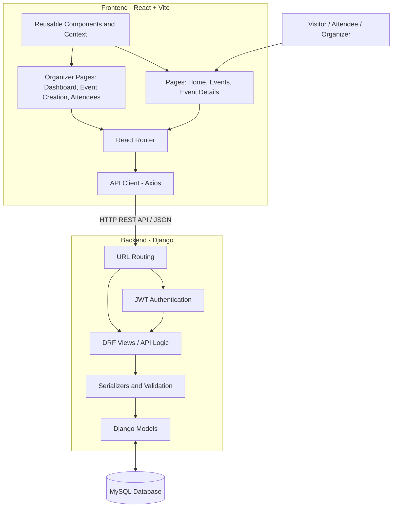
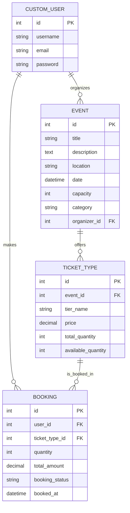

# EventPulse

**EventPulse** is a web-based event management and ticket booking platform. It brings event discovery, organizer workflows, ticket selection, booking confirmation, and attendee management into one application.

The project uses a React frontend and a Django REST Framework backend backed by MySQL. The frontend communicates with the backend through REST API endpoints, and authenticated requests use JSON Web Tokens (JWT).

> **Project status:** This README describes the application structure and workflows implemented in the current project code discussed by the team. Update the configuration notes and endpoint list if the repository changes.

---

## Table of Contents

- [Highlights](#highlights)
- [Technology Stack](#technology-stack)
- [Application Architecture](#application-architecture)
- [Database Design](#database-design)
- [Main Workflows](#main-workflows)
- [API Overview](#api-overview)
- [Project Structure](#project-structure)
- [Prerequisites](#prerequisites)
- [Getting Started](#getting-started)
  - [1. Clone the repository](#1-clone-the-repository)
  - [2. Create the MySQL database](#2-create-the-mysql-database)
  - [3. Configure the backend environment](#3-configure-the-backend-environment)
  - [4. Create and activate a Python virtual environment](#4-create-and-activate-a-python-virtual-environment)
  - [5. Install backend dependencies](#5-install-backend-dependencies)
  - [6. Apply database migrations](#6-apply-database-migrations)
  - [7. Create an administrator account](#7-create-an-administrator-account)
  - [8. Start the Django backend](#8-start-the-django-backend)
  - [9. Install and start the frontend](#9-install-and-start-the-frontend)
- [Using the Application](#using-the-application)
- [Environment and Security Notes](#environment-and-security-notes)
- [Common Setup Issues](#common-setup-issues)
- [Development Workflow](#development-workflow)
- [Contributing](#contributing)
- [License](#license)

---

## Highlights

### For visitors and attendees

- Browse available events.
- Search events and filter them by category.
- View event information, venue, date, capacity, and ticket tiers.
- Register for an account and sign in.
- Select ticket quantities while respecting the available ticket inventory shown by the application.
- Submit a booking and view its booking confirmation/pass.

### For organizers

- View a dashboard with total revenue, tickets sold, and active events.
- Create events with details such as title, description, category, date, venue, and capacity.
- Configure multiple ticket tiers, with a price and quantity for each tier.
- View attendee booking records for an event.
- Search attendee records and export the filtered list as CSV.

### Interface

- Responsive layouts for mobile, tablet, and desktop viewports.
- Reusable layout components such as the navigation bar and footer.
- Toast notifications for user feedback.

---

## Technology Stack

| Layer | Technology | Responsibility |
|---|---|---|
| Frontend | React, JavaScript | Builds the interactive user interface |
| Frontend tooling | Vite | Runs the frontend development server and build tooling |
| Styling | Tailwind CSS | Responsive styling and layout |
| Routing | React Router | Handles client-side page navigation |
| HTTP client | Axios | Sends requests to the backend API |
| Backend | Python, Django | Application backend and server-side logic |
| API | Django REST Framework | Exposes REST API endpoints and serializes data |
| Authentication | Simple JWT | Issues and validates access/refresh tokens |
| Database | MySQL | Stores users, events, ticket tiers, and bookings |

---

## Application Architecture

The application is separated into a frontend, backend API, and relational database. The React application renders pages and components. It calls the Django REST API through the shared API client. Django validates requests, runs application logic, and reads or writes records in MySQL.



### Request flow

1. A user opens a page in the React application.
2. A page or component requests data using the shared Axios API client.
3. The request reaches a Django REST Framework endpoint.
4. For protected endpoints, JWT authentication checks the supplied access token.
5. The backend validates the input and uses Django models to access MySQL.
6. The API returns a JSON response, which the frontend displays.

The frontend API client is currently configured to use:

```text
http://127.0.0.1:8000/api
```

The Vite development server is normally available at:

```text
http://localhost:5173
```

---

## Database Design

The core database entities are `CustomUser`, `Event`, `TicketType`, and `Booking`.

### Entity relationship diagram



### Entity descriptions

| Entity | Purpose | Important fields |
|---|---|---|
| `CustomUser` | Application user account based on Django's `AbstractUser` | `id`, `username`, `email`, and Django's inherited authentication fields |
| `Event` | An event created and managed by an organizer | `title`, `description`, `location`, `date`, `capacity`, `category`, `organizer_id` |
| `TicketType` | A ticket tier belonging to an event | `event_id`, `tier_name`, `price`, `total_quantity`, `available_quantity` |
| `Booking` | A user's booking for a ticket tier | `user_id`, `ticket_type_id`, `quantity`, `total_amount`, `booking_status`, `booked_at` |

### Relationships

- One user can organize multiple events. Each event references its organizer through `organizer_id`.
- One event can offer multiple ticket tiers. Each ticket tier belongs to one event through `event_id`.
- One user can make multiple bookings. Each booking references the user through `user_id`.
- One ticket tier can be referenced by multiple bookings. Each booking references its selected tier through `ticket_type_id`.

> The diagram shows the core model relationships and fields known from the project. Django's inherited user fields and any additional fields in your current models may not all be displayed. Keep this diagram synchronized with `events/models.py` whenever the schema changes.

---

## Main Workflows

### Account registration and login

1. A visitor submits the registration form.
2. The frontend sends the registration data to the backend.
3. The user signs in through the token endpoint.
4. The backend returns JWT access and refresh tokens.
5. The frontend stores the tokens and attaches the access token to protected API requests.

### Event creation

1. An organizer opens the create-event page.
2. The organizer enters event information and configures one or more ticket tiers.
3. The frontend validates required fields, capacity, ticket quantities, and prices.
4. The frontend submits the event and nested ticket-tier data to the backend.
5. The organizer is navigated to the newly created event page after success.

### Ticket booking

1. A user opens an event details page.
2. The user chooses a ticket tier and quantity.
3. The frontend submits the selected ticket type and quantity to the booking API.
4. The backend validates the request and available inventory.
5. The frontend opens the booking confirmation page for the created booking.

The backend booking implementation uses a database transaction and row locking to re-check ticket inventory during concurrent booking requests. This helps prevent more tickets being booked than are available when multiple requests arrive at the same time.

### Attendee management

1. An organizer opens attendee management for one of their events.
2. The page requests attendee records and summary totals from the backend.
3. The organizer can search by attendee username, email, or ticket tier.
4. The organizer can export the currently filtered attendee list as a CSV file.

---

## API Overview

The frontend API client uses the `/api` base path. The following routes are referenced by the current frontend implementation:

| Method | Endpoint | Purpose |
|---|---|---|
| `POST` | `/api/register/` | Register a user |
| `POST` | `/api/token/` | Obtain JWT tokens |
| `POST` | `/api/token/refresh/` | Refresh an access token |
| `GET` | `/api/events/` | List events; supports search and category filters in the frontend |
| `POST` | `/api/events/` | Create an event with ticket tiers |
| `GET` | `/api/events/{id}/` | Retrieve event details |
| `POST` | `/api/bookings/` | Create a ticket booking |
| `GET` | `/api/bookings/{id}/` | Retrieve booking confirmation data |
| `GET` | `/api/organizer/dashboard/` | Retrieve organizer metrics and event list |
| `GET` | `/api/organizer/events/{eventId}/attendees/` | Retrieve attendee records; supports search and CSV export parameters |

For attendee export, the frontend sends `format=csv`. For attendee search, it sends a `search` query parameter.

> Treat this as a frontend-referenced endpoint overview, not a replacement for the backend URL configuration. Confirm the exact methods, permissions, request schemas, and response schemas in the Django URL, view, and serializer files before publishing API documentation for external developers.

---

## Project Structure

The following is a logical overview of the repository. Some backend files may be arranged differently in your checkout; use the actual repository tree as the source of truth.

```text
EventPulse/
├── frontend/
│   ├── public/
│   ├── src/
│   │   ├── api/                  # Axios client and API functions
│   │   ├── components/
│   │   │   ├── events/           # Event and ticket UI components
│   │   │   └── layout/           # Navbar and Footer
│   │   ├── context/              # Shared React context (e.g. toast)
│   │   ├── pages/                # User and organizer pages
│   │   ├── App.jsx               # Application routes/layouts
│   │   └── main.jsx              # Frontend entry point
│   ├── package.json
│   └── vite.config.js
│
├── config/                       # Django project configuration
├── events/                       # Event, ticket, booking models and API logic
├── manage.py                     # Django management entry point (if at repo root)
├── requirements.txt              # Backend dependencies (if included)
├── .env                          # Local secrets; do not commit
├── .gitignore
└── README.md
```

---

## Prerequisites

Install the following before setting up the project:

- Git
- Python and pip
- Node.js and npm
- MySQL Server
- A code editor such as Visual Studio Code

Use the dependency versions declared in the repository where available. The development environment previously used Python 3.14.7, Django 6.1.1, and Vite 8.3.1. The Django MySQL backend in that environment rejected MySQL 8.0.46 and reported that MySQL 8.4 or later was required. Use a MySQL version supported by the installed Django version; do not assume that every Django/MySQL combination is compatible.

---

## Getting Started

The commands below are written for **Windows PowerShell**. Run backend commands from the directory containing `manage.py`. In the current local setup, the repository root is:

```text
C:\Users\hp\Desktop\WEB DEV\EventPulse
```

### 1. Clone the repository

If you have not already cloned the project, open PowerShell and run:

```powershell
git clone <YOUR_GITHUB_REPOSITORY_URL>
cd EventPulse
```

**Why?** Cloning downloads the project source code and Git history to your computer. The `cd` command moves the terminal into the project directory so later commands run in the correct location.

If the project is already on your computer, just open PowerShell in the existing `EventPulse` folder. Do not clone it again into itself.

### 2. Create the MySQL database

Open MySQL Workbench or the MySQL command-line client and run:

```sql
CREATE DATABASE eventpulse_db
  CHARACTER SET utf8mb4
  COLLATE utf8mb4_unicode_ci;
```

**Why?** Django needs a database in which to create the application's tables. Creating the database first gives the backend a known database name to use when it connects to MySQL.

If `eventpulse_db` already exists, do not create it again. Confirm that the database user configured for Django has permission to access it.

### 3. Configure the backend environment

Create a local `.env` file in the backend configuration location expected by `config/settings.py`. In the current setup, this is typically the directory containing `manage.py`.

A possible template is shown below. **The variable names must match the names read by your actual `config/settings.py`; change the names if your settings use different ones.**

```env
SECRET_KEY=replace-with-a-local-secret-key
DEBUG=True
DB_NAME=eventpulse_db
DB_USER=root
DB_PASSWORD=your_mysql_password
DB_HOST=127.0.0.1
DB_PORT=3306
```

**Why?** The `.env` file keeps machine-specific configuration and secrets out of the source code. It also lets each developer use their own local database credentials without changing the project files.

Do not commit the real `.env` file. Add it to `.gitignore`, and consider committing a `.env.example` containing placeholder values so other developers know which variables to configure.

### 4. Create and activate a Python virtual environment

From the folder containing `manage.py`, run:

```powershell
python -m venv venv
.\venv\Scripts\Activate.ps1
```

If PowerShell blocks activation because of the execution policy, use the following command for the current terminal session and then activate the environment again:

```powershell
Set-ExecutionPolicy -Scope Process -ExecutionPolicy Bypass
.\venv\Scripts\Activate.ps1
```

**Why?** A virtual environment isolates this project's Python packages from other Python projects on your computer. This reduces dependency conflicts and makes the setup easier to reproduce.

When activation succeeds, PowerShell normally shows `(venv)` at the beginning of the prompt.

### 5. Install backend dependencies

If the repository contains `requirements.txt`, run:

```powershell
pip install -r requirements.txt
```

If there is no dependency file, install the packages required by the backend. The project uses Django, Django REST Framework, Simple JWT, CORS support, environment-variable loading, and a MySQL database driver. Confirm the exact driver and versions from the existing project configuration before installing packages manually.

**Why?** The backend needs its Python packages before Django can start, connect to MySQL, authenticate users, and serve API requests. A dependency file is preferable because it records the packages expected by the project.

### 6. Apply database migrations

Run:

```powershell
python manage.py migrate
```

**Why?** Migrations translate the Django model schema into database tables and apply schema changes in the correct order. On a new local database, this creates the tables required by the application.

Do not run `makemigrations` as a routine setup command unless you have changed Django models and need to generate a new migration. Existing migration files should be committed to Git and applied using `migrate`.

### 7. Create an administrator account

Run:

```powershell
python manage.py createsuperuser
```

Follow the prompts to create the account.

**Why?** A superuser can sign in to Django's admin interface, if the admin site is enabled and the relevant models are registered. This is useful for inspecting and managing backend data during development.

### 8. Start the Django backend

Run:

```powershell
python manage.py runserver
```

The backend should be available at:

```text
http://127.0.0.1:8000/
```

The frontend API client currently sends API requests to:

```text
http://127.0.0.1:8000/api
```

**Why?** The backend development server receives API requests from the React application. Keep this terminal open while using the frontend. Stop the server with `Ctrl + C`.

### 9. Install and start the frontend

Open a **second PowerShell terminal**. Move to the frontend directory:

```powershell
cd "C:\Users\hp\Desktop\WEB DEV\EventPulse\frontend"
```

Install frontend dependencies:

```powershell
npm install
```

Start the Vite development server:

```powershell
npm run dev
```

Open the local URL printed by Vite. In the current setup, it is usually:

```text
http://localhost:5173/
```

**Why?** `npm install` downloads the packages declared in `package.json`. `npm run dev` starts the React development server, which serves the UI and supports fast feedback while developing.

Keep both terminals running: one for Django and one for Vite.

---

## Using the Application

After both servers are running:

1. Open `http://localhost:5173/` in your browser.
2. Browse the events page and open an event to view its details.
3. Register a user account and sign in.
4. Use an organizer account to create an event and configure ticket tiers.
5. Open an event as an attendee, select tickets, and submit a booking.
6. Open the booking confirmation page to view or print the booking pass.
7. From the organizer dashboard, open attendee management to search records or export CSV.

The exact pages and permissions available depend on the account and backend authorization rules configured in the project.

---

## Environment and Security Notes

- Never commit `.env`, database passwords, production secret keys, or real user data.
- Keep `.env.example` limited to variable names and safe placeholder values.
- Use `DEBUG=True` only for local development. Set `DEBUG=False` and configure appropriate production settings before deployment.
- Restrict CORS to trusted frontend origins. The local frontend origin currently configured in the project is `http://localhost:5173`.
- Use HTTPS and secure secret management in production.
- Do not expose database credentials or JWT secrets in frontend code.
- Verify organizer authorization on the backend. Hiding a frontend link is not a substitute for server-side permission checks.
- Keep migrations, dependency files, and API documentation in version control.

---

## Common Setup Issues

### MySQL version compatibility error

If Django raises `NotSupportedError` while connecting to MySQL, check the MySQL server version and the database requirements of the installed Django version. In the previously observed EventPulse environment, MySQL 8.0.46 was rejected and Django reported a requirement for MySQL 8.4 or later.

### Access denied for MySQL user

Check the database name, username, password, host, port, and the user's privileges. Also confirm that the `.env` variable names match the ones read by `config/settings.py`.

### Frontend cannot reach the backend

- Confirm that Django is running at `http://127.0.0.1:8000/`.
- Confirm that the frontend API base URL points to `http://127.0.0.1:8000/api`.
- Confirm that `http://localhost:5173` is allowed in Django's CORS configuration.
- Check the browser console and Django terminal for the actual error.

### JWT or authentication errors

Sign in again to obtain a valid access token. Check that protected requests include the `Authorization: Bearer <access-token>` header and that the token refresh endpoint is configured correctly.

### PowerShell cannot activate the virtual environment

For the current terminal only, run:

```powershell
Set-ExecutionPolicy -Scope Process -ExecutionPolicy Bypass
.\venv\Scripts\Activate.ps1
```

### Port already in use

If port `8000` or `5173` is occupied, stop the other process using that port or start the corresponding development server on a different port. If you change the frontend port, update Django's CORS allowed origins as well.

---

## Development Workflow

A typical workflow for making and sharing changes is:

```powershell
# From the repository root
git pull origin main

# After editing files
git status
git add -A
git diff --cached --check
git commit -m "Describe your change"
git push origin main
```

**Why these commands?**

- `git pull` brings the latest shared changes into your local branch.
- `git status` shows which files have changed.
- `git add -A` stages modified, new, and deleted files across the repository.
- `git diff --cached --check` checks staged changes for whitespace errors.
- `git commit` records a local snapshot with a descriptive message.
- `git push` uploads the commit to the remote repository.

Before committing, inspect the staged files and make sure local secrets, virtual environments, `node_modules`, build output, and database files are not included.

---

## Contributing

1. Create a branch for your change when working with a team.
2. Keep frontend components and backend responsibilities separated.
3. Validate API input on the backend; frontend validation is for user experience and is not a security boundary.
4. Add or update migrations when models change.
5. Update this README when setup steps, models, endpoints, or major workflows change.
6. Test the affected workflow before opening a pull request.

---

## License

No license information has been provided in the current project context. Add a `LICENSE` file and update this section before distributing the project publicly. Until then, do not assume that the repository grants permission for reuse.
